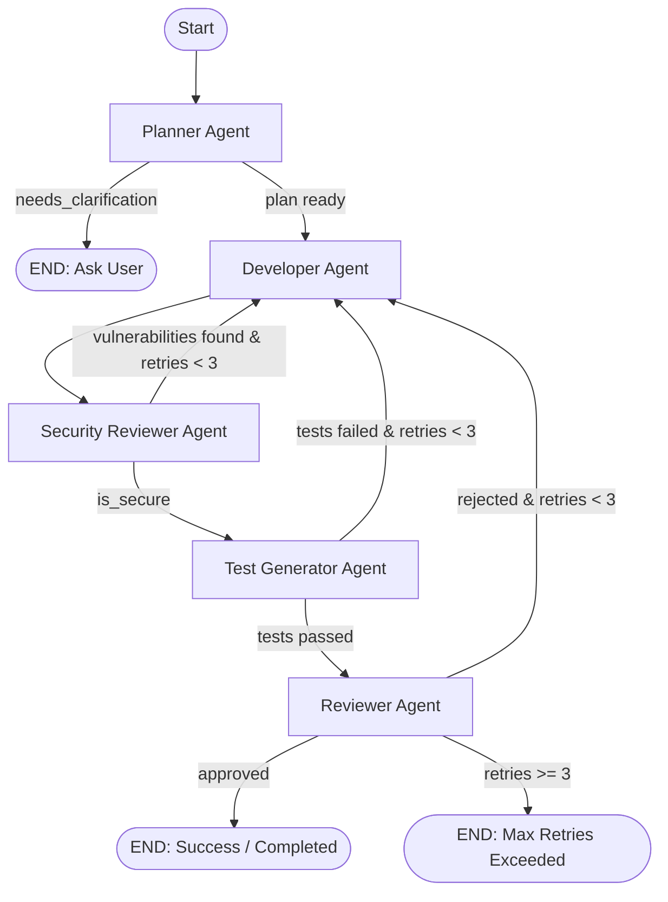
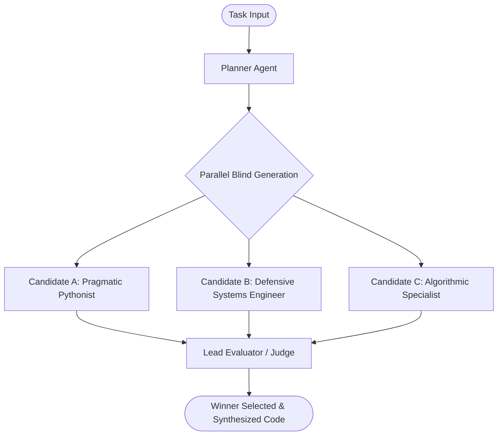

# DevPilot: Autonomous Multi-Agent AI Software Engineering System

[](run_tests.py)
[](https://github.com/langchain-ai/langgraph)
[](https://fastapi.tiangolo.com)
[](https://www.python.org/)

**DevPilot** is an autonomous multi-agent software engineering platform that transforms natural-language specifications into verified, secure, and tested Python software solutions using **LangGraph**, **FastAPI**, isolated tool execution, dedicated security auditing, and automated unit testing.

---

## Architecture Overview

DevPilot provides two complementary execution modes:
1. **Full Production Self-Correction Pipeline:** Sequential cyclic graph with dedicated Planning, Implementation, Security Review, Automated Test Generation, and Final Review with retry limits.
2. **Blind Independent Subagents + Evaluator Mode:** Parallel isolated subagent generation to prevent anchoring bias, followed by a multi-criteria judge.

### 1. Production Pipeline Graph



### 2. Blind Independent Subagents + Evaluator Graph



---

## Agent Roster & Specializations

| Agent | Core Responsibility | Temperature |
|---|---|---|
| **Planner** | Analyzes task ambiguity, requests clarification, or breaks down implementation steps | 0.7 |
| **Developer** | Generates executable code and selects the appropriate tool (`run_python_code`, `write_file`, `run_shell_command`) | 0.7 |
| **Security Reviewer** | Audits code for command injection, hardcoded credentials, unsafe shell calls, and path traversal | 0.1 |
| **Test Generator** | Generates comprehensive `pytest` unit test suites and executes them in an isolated test runner | 0.2 |
| **Reviewer** | Assesses functional correctness against task requirements and manages approval state | 0.3 |
| **Blind Subagents** | Three isolated agents with orthogonal perspectives (Pragmatic, Defensive, Algorithmic) | 0.7 |
| **Evaluator** | Evaluates blind candidates across Correctness (40%), Robustness (25%), Efficiency (15%), and Quality (20%) | 0.2 |

---

## Security Engineering & Sandboxing

LLM-generated code execution is secured using a defense-in-depth model:

1. **Environment Credential Isolation (`get_sanitized_env`):**
   - Automatically strips all sensitive keys (`OPENAI_API_KEY`, `GEMINI_API_KEY`, `DATABASE_URL`, `API_KEY`, AWS tokens) before child process spawning.
2. **Subprocess Timeout Enforcement:**
   - Enforces a hard timeout (`EXECUTION_TIMEOUT_SECONDS=10`) preventing infinite loops and denial-of-service hanging.
3. **Shell Command Restriction:**
   - Removed `shell=True`. Commands are tokenized via `shlex.split`.
   - Whitelist validation (`python`, `pip`, `pytest`, `git`, `echo`, `cat`, `dir`, `ls`, `mkdir`, `type`).
   - Destructive command patterns (`rm -rf`, `del /`, `format`, `curl`, `wget`, `nc`, `shutdown`) are intercepted and blocked.
4. **Filesystem Path Confinement:**
   - File creation via `write_file` is strictly confined within `workspace/` using canonical path validation (`os.path.abspath`).
   - Directory traversal (`../../`) and absolute paths are blocked.
   - Writing to sensitive files (`.env`, `Dockerfile`, `docker-compose.yml`) is prohibited.
5. **Disk Cleanliness:**
   - Executions use `tempfile.TemporaryDirectory()` context managers, guaranteeing 100% cleanup of all temporary code files.

---

## Shared State Model (`AppState`)

All agents communicate via a unified, Pydantic-validated state:

```python
class AppState(BaseModel):
    task: str
    discussion: List[Message] = Field(default_factory=list)
    plan: Optional[List[str]] = None

    # Code and Artifacts
    code: Optional[str] = None
    files_modified: List[str] = Field(default_factory=list)
    tool_used: Optional[str] = None
    filename: Optional[str] = None
    execution_result: Optional[str] = None

    # Automated Testing
    test_code: Optional[str] = None
    test_results: Optional[str] = None
    tests_passed: Optional[bool] = None

    # Dedicated Security Review
    security_review: Optional[SecurityReviewOut] = None

    # Reviewer & Feedback
    feedback: Optional[str] = None
    approved: Optional[bool] = None

    # Blind Evaluation Candidates
    candidates: List[CandidateSolution] = Field(default_factory=list)
    evaluation: Optional[EvaluatorOut] = None
    winner: Optional[str] = None

    # Lifecycle State
    current_stage: str = "initialized"
    round: int = 0
    max_rounds: int = 3
    final_status: str = "pending"
    needs_clarification: bool = False
    clarification_question: Optional[str] = None
```

---

## Quickstart & Verification

### 1. Setup Virtual Environment
```bash
python -m venv .venv
# Windows:
.\.venv\Scripts\activate
# Linux/macOS:
source .venv/bin/activate

pip install -r requirements.txt
```

### 2. Configure Environment (`.env`)
```ini
LLM_PROVIDER=openai
OPENAI_API_KEY=sk-...
OPENAI_MODEL=gpt-4o-mini

# Or Google Gemini:
# LLM_PROVIDER=gemini
# GEMINI_API_KEY=...
# GEMINI_MODEL=gemini-1.5-flash

DATABASE_URL=sqlite:///./devpilot.db
MAX_ROUNDS=3
EXECUTION_TIMEOUT_SECONDS=10
```

### 3. Run the Verified Test Suite (38 Tests)
```bash
python run_tests.py
```
*Output: 38 passed, 0 failed across all 10 modules in ~23s.*

### 4. Run the Blind Subagents + Evaluator Demo
```bash
python demo_blind_evaluation.py "Write a Python function to solve the Two-Sum problem efficiently and handle edge cases."
```

### 5. Run the Evaluation Benchmark
```bash
python evals/run_evals.py
```

### 6. Start the API Server & Web UI
```bash
uvicorn app.main:app --reload --port 8000
```
Open `frontend/index.html` in your browser to interact with the real-time Server-Sent Events (SSE) interface.

---

## Technical Documentation

- [docs/INITIAL_CODEBASE_AUDIT.md](docs/INITIAL_CODEBASE_AUDIT.md): Detailed pre-refactoring architectural audit and vulnerability inventory.
- [docs/ARCHITECTURE_AND_IMPROVEMENTS.md](docs/ARCHITECTURE_AND_IMPROVEMENTS.md): In-depth architectural design, threat modeling, and implementation decisions.
- [docs/INTERVIEW_PREPARATION_GUIDE.md](docs/INTERVIEW_PREPARATION_GUIDE.md): Technical Q&A covering state machines, security sandboxing, and agent design trade-offs.
