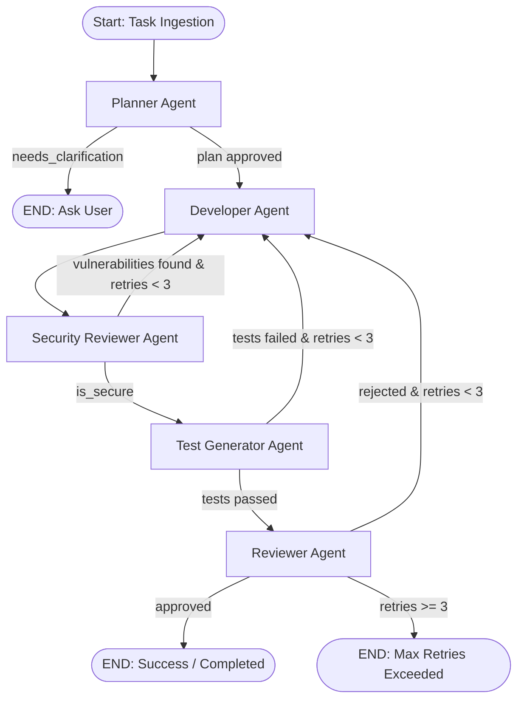
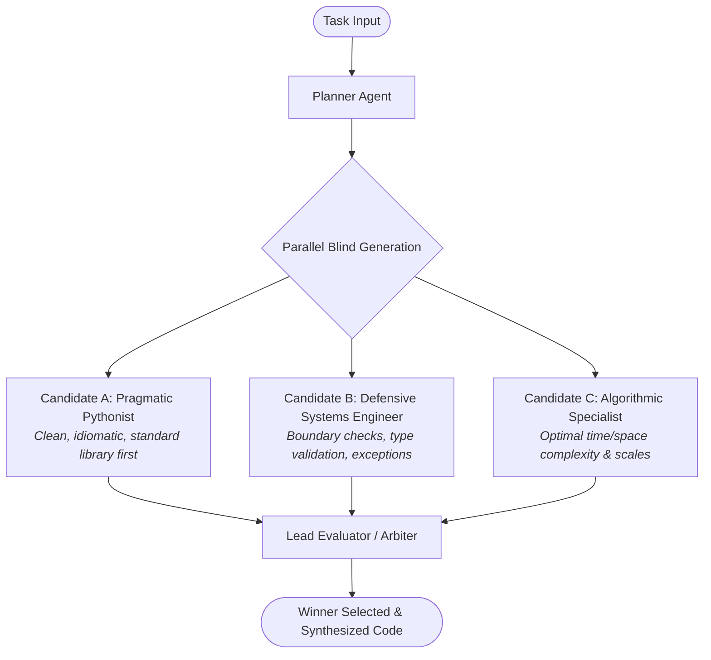

# DevPilot: Autonomous Multi-Agent AI Software Engineering System

[](https://devpilot-tdjx.onrender.com/)
[](https://devpilot-tdjx.onrender.com/docs)
[](https://devpilot-tdjx.onrender.com/api/v1/health)
[-brightgreen?style=for-the-badge&logo=pytest&logoColor=white)](run_tests.py)
[](https://github.com/langchain-ai/langgraph)
[](https://www.python.org/)

---

### 🌐 Live Production Deployments & Links

| Service | Live URL | Description |
|:---|:---|:---|
| **🚀 Production Web App** | [https://devpilot-tdjx.onrender.com/](https://devpilot-tdjx.onrender.com/) | Live interactive developer dashboard with real-time SSE streaming |
| **📑 Swagger API Docs** | [https://devpilot-tdjx.onrender.com/docs](https://devpilot-tdjx.onrender.com/docs) | Interactive OpenAPI / Swagger UI test harness |
| **🩺 Live Health Probe** | [https://devpilot-tdjx.onrender.com/api/v1/health](https://devpilot-tdjx.onrender.com/api/v1/health) | Real-time database and service healthcheck endpoint |
| **📖 ReDoc Schema** | [https://devpilot-tdjx.onrender.com/redoc](https://devpilot-tdjx.onrender.com/redoc) | Alternative structured technical API documentation |

---

## Executive Summary

**DevPilot** is an autonomous multi-agent software engineering platform that converts natural language requirements into verified, production-grade Python software. Unlike naive linear chains or unconstrained ReAct loops, DevPilot uses **LangGraph cyclic state machines**, **defense-in-depth execution sandboxing**, **automated dynamic pytest generation**, and a **Blind Subagents consensus architecture** that eliminates LLM anchoring bias.

### Key Capabilities
- **Cyclic Self-Correcting Graph:** Deterministic state machine navigating Planning $\rightarrow$ Implementation $\rightarrow$ Security Review $\rightarrow$ Automated Pytest $\rightarrow$ Code Review with bounded retry loops (`MAX_ROUNDS=3`).
- **Blind Independent Subagents Consensus:** Generates 3 parallel candidate implementations in complete isolation (Pragmatic, Defensive, Algorithmic personas) before an objective multi-criteria judge picks or synthesizes the best solution.
- **Enterprise Security Sandbox:** Subprocess credential stripping (`get_sanitized_env`), command tokenization without `shell=True`, binary whitelisting, hard timeouts, and path traversal confinement (`workspace/`).
- **Dynamic Pytest Runner:** Generates exhaustive unit test suites on the fly, runs them in ephemeral sandboxes, and feeds structured error traces back to the developer agent on failure.
- **Multi-Model Provider:** Out-of-the-box support for **Google Gemini 3.8 Flash** and **OpenAI GPT-4o / GPT-4o-mini**.
- **Real-Time Developer Dashboard:** Clean, white/slate GitHub-grade interface with Server-Sent Events (SSE) streaming, terminal log execution, SAST security tables, and code copy tools.

---

## Architecture Overview

DevPilot implements two distinct execution modes:

### 1. Production Pipeline Graph (Cyclic Self-Correction)



### 2. Blind Independent Subagents + Evaluator Graph (Bias Mitigation)



---

## Specialized Agent Roster

| Agent | Core Responsibility | Prompt Strategy & Persona | Temp |
|:---|:---|:---|:---:|
| **Planner** | Deconstructs ambiguous user tasks into sequential milestones; prompts for clarification if specifications lack critical requirements. | Systems Architect | 0.7 |
| **Developer** | Generates executable, production-grade Python code and manages file / shell execution tools. | Senior Software Engineer | 0.7 |
| **Security Reviewer** | Audits code against SAST rules: command injection, hardcoded credentials, unsafe shell invocations, and path traversal. | Application Security Engineer | 0.1 |
| **Test Generator** | Synthesizes comprehensive `pytest` test suites covering edge cases, happy paths, and error scenarios. Executes tests in sandboxed processes. | QA Automation Lead | 0.2 |
| **Reviewer** | Evaluates code against functional requirements, architectural elegance, and test pass criteria before issuing final sign-off. | Engineering Director | 0.3 |
| **Subagent A (Pragmatic)** | Solves the problem using clean, readable, standard-library-first Python. | Practical Developer | 0.7 |
| **Subagent B (Defensive)** | Focuses on fail-safes, strict input validation, edge cases, and robust exception hierarchies. | Defensive Systems Engineer | 0.7 |
| **Subagent C (Algorithmic)** | Focuses on minimal time/space complexity, asymptotic scaling, and data structure selection. | Performance Specialist | 0.7 |
| **Lead Evaluator** | Objectively scores blind candidates across Correctness (40%), Robustness (25%), Efficiency (15%), and Quality (20%). | Principal Architect / Arbiter | 0.2 |

---

## Defense-in-Depth Security Engineering

DevPilot treats all LLM-generated code as untrusted input. The execution engine enforces strict controls:

1. **Subprocess Credential Stripping (`get_sanitized_env`):**
   - Automatically cleans all sensitive environment variables (`OPENAI_API_KEY`, `GEMINI_API_KEY`, `DATABASE_URL`, AWS credentials) before spawning any child process.
2. **Subprocess Timeout Enforcement:**
   - Enforces a hard timeout (`EXECUTION_TIMEOUT_SECONDS=10`) per execution, killing runaway processes or infinite loops.
3. **No Shell Invocations (`shell=False`):**
   - Commands are parsed into discrete tokens via `shlex.split`. Shell expansion and arbitrary string piping are blocked.
4. **Binary Whitelist & Destructive Command Interceptor:**
   - Permitted binaries: `python`, `pip`, `pytest`, `git`, `echo`, `cat`, `dir`, `ls`, `mkdir`, `type`.
   - Destructive patterns (`rm -rf`, `del /`, `format`, `curl`, `wget`, `nc`, `shutdown`) are intercepted and rejected.
5. **Canonical Path Confinement:**
   - File manipulation via `write_file` is strictly restricted to `workspace/` via canonical path checking (`os.path.abspath`). Traversal attempts (`../../`) and writes to protected files (`.env`, `Dockerfile`) are blocked.
6. **Ephemeral Disk Cleanliness:**
   - Test executions use `tempfile.TemporaryDirectory()` context managers to ensure 100% cleanup of generated artifacts.

---

## State Schema (`AppState`)

All agents communicate via a typed, validated Pydantic v2 schema:

```python
class AppState(BaseModel):
    task: str
    discussion: List[Message] = Field(default_factory=list)
    plan: Optional[List[str]] = None

    # Code & Execution Artifacts
    code: Optional[str] = None
    files_modified: List[str] = Field(default_factory=list)
    tool_used: Optional[str] = None
    filename: Optional[str] = None
    execution_result: Optional[str] = None

    # Automated Testing
    test_code: Optional[str] = None
    test_results: Optional[str] = None
    tests_passed: Optional[bool] = None

    # Dedicated Security Review
    security_review: Optional[SecurityReviewOut] = None

    # Reviewer & Feedback
    feedback: Optional[str] = None
    approved: Optional[bool] = None

    # Blind Evaluation Candidates
    candidates: List[CandidateSolution] = Field(default_factory=list)
    evaluation: Optional[EvaluatorOut] = None
    winner: Optional[str] = None

    # Lifecycle State
    current_stage: str = "initialized"
    round: int = 0
    max_rounds: int = 3
    final_status: str = "pending"
    needs_clarification: bool = False
    clarification_question: Optional[str] = None
```

---

## Quickstart Guide

### Option A: Use the Live Deployed Cloud Instance

You can immediately explore the live system without installing anything locally:
- **Web App Dashboard:** [https://devpilot-tdjx.onrender.com/](https://devpilot-tdjx.onrender.com/)
- **Swagger API Explorer:** [https://devpilot-tdjx.onrender.com/docs](https://devpilot-tdjx.onrender.com/docs)
- **Healthcheck:** [https://devpilot-tdjx.onrender.com/api/v1/health](https://devpilot-tdjx.onrender.com/api/v1/health)

---

### Option B: Local Development Setup

#### 1. Clone & Setup Virtual Environment
```bash
git clone https://github.com/Adityaa0124/devpilot.git
cd devpilot

python -m venv .venv

# On Windows:
.\.venv\Scripts\activate

# On Linux / macOS:
source .venv/bin/activate

pip install -r requirements.txt
```

#### 2. Configure Environment (`.env`)
```ini
# Google Gemini (Default)
LLM_PROVIDER=gemini
GEMINI_API_KEY=your_gemini_api_key_here
GEMINI_MODEL=gemini-3.8-flash

# Or OpenAI
# LLM_PROVIDER=openai
# OPENAI_API_KEY=sk-...
# OPENAI_MODEL=gpt-4o-mini

DATABASE_URL=sqlite:///./devpilot.db
MAX_ROUNDS=3
EXECUTION_TIMEOUT_SECONDS=10
ALLOW_SHELL_EXECUTION=true
```

#### 3. Run the Verified Test Suite (38 / 38 Tests)
```bash
python run_tests.py
```
*Result: 38 passed, 0 failed across all 10 modules in ~12 seconds.*

#### 4. Run the Blind Subagents + Evaluator Demo
```bash
# With live LLM:
python demo_blind_evaluation.py "Write a Python function to solve the Two-Sum problem efficiently and handle edge cases."

# Mock mode (no API key required):
python demo_blind_evaluation.py --mock
```

#### 5. Run the Automated Benchmark Suite
```bash
python evals/run_evals.py
```

#### 6. Start the API Server & Web UI
```bash
python -m uvicorn app.server:app --port 8001 --reload
```
Navigate to `http://localhost:8001` in your browser. The frontend is served directly by the FastAPI backend.

---

## API Reference

| Method | Endpoint | Description |
|:---|:---|:---|
| `GET` | `/` | Web Application Dashboard (Served directly from `frontend/index.html`) |
| `GET` | `/docs` | Interactive Swagger / OpenAPI documentation |
| `GET` | `/redoc` | ReDoc API documentation schema |
| `GET` | `/api/v1/health` | System health probe (returns database and service status) |
| `POST` | `/api/v1/tasks` | Create and execute an autonomous engineering task |
| `GET` | `/api/v1/tasks/{id}/events` | Real-time Server-Sent Events (SSE) task streaming |
| `GET` | `/api/v1/tasks/{id}` | Retrieve task state, generated code, test results, and reviews |
| `POST` | `/api/v1/blind-evaluate` | Run the Blind Independent Subagents + Evaluator pipeline |

---

## Verified Test Suite Breakdown

| Test File | Focus Area | Status |
|:---|:---|:---:|
| `test_models.py` | Pydantic v2 `AppState`, `Message`, and stage validators | Pass (5/5) |
| `test_database.py` | SQLite session lifecycle and migration schema | Pass (3/3) |
| `test_llm_factory.py` | Google Gemini & OpenAI provider initialization | Pass (3/3) |
| `test_tools.py` | Execution sandboxing, timeout enforcement, directory isolation | Pass (4/4) |
| `test_agents.py` | Unit prompt formatting and agent response structures | Pass (5/5) |
| `test_graph.py` | LangGraph conditional routing and state transitions | Pass (3/3) |
| `test_security_agent.py`| SAST vulnerability detection and prompt injection defenses | Pass (4/4) |
| `test_test_generator.py`| Dynamic `pytest` test generation and isolated execution | Pass (4/4) |
| `test_blind_subagents.py`| Persona divergence, blind isolation, and judge rubrics | Pass (4/4) |
| `test_api.py` | FastAPI endpoints, health probes, and task SSE streaming | Pass (3/3) |
| **Total** | **Comprehensive Full-System Coverage** | **38 / 38 (100%)** |

---

## Deep-Dive Technical Documentation

- **[Portfolio Executive Summary](docs/PORTFOLIO_EXECUTIVE_SUMMARY.md):** Complete portfolio overview, resume bullet points, and comparative analysis with DataPilot.
- **[Architecture & Design Decisions](docs/ARCHITECTURE_AND_IMPROVEMENTS.md):** Detailed system architecture, security threat models, and consensus mechanics.
- **[Initial Codebase Audit](docs/INITIAL_CODEBASE_AUDIT.md):** Pre-refactoring audit detailing legacy vulnerabilities and architectural bottlenecks.
- **[Technical Interview Preparation Guide](docs/INTERVIEW_PREPARATION_GUIDE.md):** Rigorous technical Q&A covering state machines, cyclic graphs, bias mitigation, and sandboxing.

---

## License

This project is licensed under the MIT License — see the [LICENSE](LICENSE) file for details.
